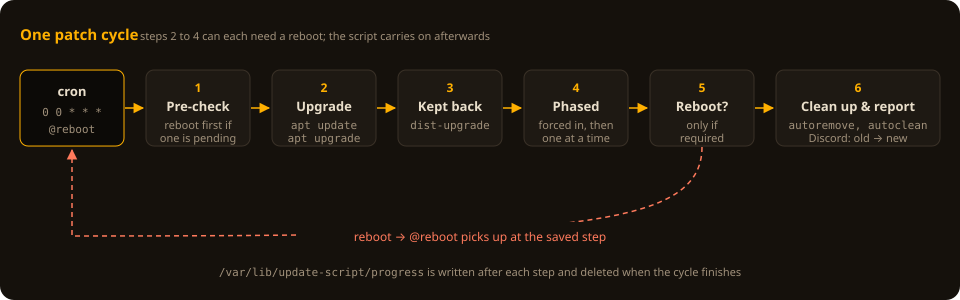

<h1 align="center">Ubuntu Auto Update</h1>

<p align="center">
  <b>Unattended patching for Ubuntu and Debian servers that finishes the job.</b><br>
  It installs phased and kept-back updates that <code>unattended-upgrades</code> leaves behind, reboots when it has to,<br>
  picks up where it left off after each reboot, and posts a Discord report of what changed.
</p>

<p align="center">
  
  
  
  
  <a href="LICENSE"></a>
</p>

<p align="center">
  <a href="https://jackwent.co.uk/ubuntu-24-04-autopatch-script/"><b>Full write-up</b></a> ·
  <a href="#quick-start">Quick start</a> ·
  <a href="#self-resuming-across-reboots">How resuming works</a> ·
  <a href="https://github.com/JackWent/HA-MQTT-Agent">HA-MQTT-Agent</a>, to watch the results in Home Assistant
</p>

<p align="center">
  
</p>

## Why not just use unattended-upgrades?

`unattended-upgrades` installs security updates, but it leaves the rest for you: **kept-back packages**, **phased updates** that Ubuntu holds back on some machines for days, and the **reboot** a new kernel needs. Servers end up with a handful of updates that never go away, and a "reboot required" flag that sits there for weeks.

This script does the whole lot in one unattended run:

- `apt upgrade`, then `dist-upgrade` for anything kept back.
- **Phased updates forced in**, then any stragglers installed one by one.
- **Reboots only when needed**, and carries on after each reboot from the step it reached.
- **Cleans up** with `autoremove` and `autoclean`, then logs whether anything is still outstanding.
- **Reports to Discord**: each package with its old and new version, reboots, anything still pending and any failed step. It stays quiet when there was nothing to do.
- **Survives the awkward cases**: it runs apt directly as root, so an autoremove that removes `sudo` can't break the rest of the run, and every prompt is answered non-interactively.

## Quick start

```bash
sudo install -d -m 0755 /opt/scripts
sudo curl -fsSL -o /opt/scripts/auto-update.sh https://raw.githubusercontent.com/JackWent/Ubuntu-Auto-Update/master/auto-update.sh
sudo chmod +x /opt/scripts/auto-update.sh
```

Make a root-only folder for its log, then add two lines to root's crontab (`sudo crontab -e`):

```bash
sudo install -d -o root -g adm -m 0750 /var/log/auto-update
```

```cron
@reboot /opt/scripts/auto-update.sh >> /var/log/auto-update/auto-update.log 2>&1
0 0 * * * /opt/scripts/auto-update.sh >> /var/log/auto-update/auto-update.log 2>&1
```

Optionally, for Discord reports, save a webhook URL where only root can read it:

```bash
sudo install -d -m 0700 /etc/auto-update
echo 'https://discord.com/api/webhooks/…' | sudo tee /etc/auto-update/discord-webhook >/dev/null
sudo chmod 600 /etc/auto-update/discord-webhook
```

> [!WARNING]
> The script **reboots the server on its own** whenever a reboot is required. Schedule it for a time when a few minutes of downtime is fine.

## What each step does

Run start-to-finish, the script works through these steps:

| Step | What happens |
|---|---|
| 1. Pre-check | If `/var/run/reboot-required` already exists (e.g. from a previous manual change), reboot immediately before doing anything else. |
| 2. Update & upgrade | `apt update`, then `apt upgrade -y` (non-interactive). |
| 3. Kept-back packages | `apt dist-upgrade -y` to pull in anything upgrade left held back. |
| 4. Phased updates | Ubuntu's phased-rollout mechanism can hold packages back even after step 3. The script forces them in with `APT::Get::Always-Include-Phased-Updates=true` on both `upgrade` and `dist-upgrade`, then falls back to installing any still-remaining upgradable packages one at a time. |
| 5. Reboot if required | Checks `/var/run/reboot-required` again; reboots if the new packages need it. |
| 6. Cleanup | `apt autoremove -y`, `apt autoclean`, then a final `apt update` + upgradable-package count so the log shows whether anything's still outstanding. If a Docker upgrade in the run restarted the daemon, any running container that bind-mounts `/var/run/docker.sock` and started before that restart is restarted so it reconnects (otherwise tools like Dockhand or Portainer show "socket not accessible" until the next manual restart). |

## Discord report

At the end of a run that installed or removed anything, rebooted, or had a failed apt step, the
script posts one message to Discord: each package with its old and new version, reboots, updates
still pending and any failed steps. A run with nothing to do sends nothing. The webhook URL is read
from `/etc/auto-update/discord-webhook` (root only, mode 600); without that file no report is sent.
Run state for the report is kept in `/var/lib/update-script/` so it survives the reboots.

## Self-resuming across reboots

Steps 2–4 can each trigger a kernel/library update that leaves the host
needing a reboot mid-cycle. Rather than skip rebooting (and leave the host on
an old kernel) or block waiting for one, the script tracks its own progress
in `/var/lib/update-script/progress` and calls `reboot` directly when needed:

```
step1_reboot   →  rebooted before any updates ran; resume at step 2
step2_updates  →  finished apt upgrade; resume at step 3
step3_kept_back → finished dist-upgrade; resume at step 4
step4_phased   →  finished phased-update pass; resume at reboot-check/cleanup
```

On a clean run (no progress file), it starts from the top. The progress file
is deleted by `cleanup()` once a full cycle finishes successfully — this is
what makes the `@reboot` cron entry safe to fire on *every* boot without
restarting a finished cycle from scratch.

**Caveat:** because the progress file only gets cleared on successful
completion, a host that's rebooted manually (or power-cycled) in the middle
of a run will resume from wherever it left off on the next boot, rather than
starting a fresh cycle. If you need to force a clean run, delete
`/var/lib/update-script/progress` first.

## Requirements

- Ubuntu/Debian host with `apt`, run as root (it calls apt directly and refuses to run as another user)
- Outbound internet access to the configured apt repositories
- `cron`

## Installation in detail

```bash
sudo install -d -m 0755 /opt/scripts
sudo cp auto-update.sh /opt/scripts/auto-update.sh
sudo chmod +x /opt/scripts/auto-update.sh
```

## Cron setup

Add to root's crontab (`sudo crontab -e`):

```cron
@reboot /opt/scripts/auto-update.sh
0 0 * * * /opt/scripts/auto-update.sh
```

- **`@reboot`** — fires on every boot. This is what lets the script continue
  a patch cycle after it reboots itself mid-run; it's a no-op (just deletes
  nothing, exits after cleanup) if there's no in-progress cycle to resume.
- **`0 0 * * *`** — starts a fresh patch cycle daily at midnight.

## Logging

The script writes progress to stdout/stderr only — it does not redirect to a
log file itself. Under cron, that output either gets mailed to root (if a
local MTA is configured) or silently discarded. To keep a persistent log,
redirect it in the crontab entry instead. Put the log in its own root-only folder rather than
straight in `/var/log`: on Ubuntu `/var/log` is writable by the `syslog` group, and cron appends to the
file as root, so a symlink planted there would make root write somewhere else.

```bash
sudo install -d -o root -g adm -m 0750 /var/log/auto-update
```

```cron
@reboot /opt/scripts/auto-update.sh >> /var/log/auto-update/auto-update.log 2>&1
0 0 * * * /opt/scripts/auto-update.sh >> /var/log/auto-update/auto-update.log 2>&1
```

A matching `/etc/logrotate.d/auto-update` keeps it in check:

```
/var/log/auto-update/auto-update.log {
    weekly
    rotate 8
    compress
    delaycompress
    missingok
    notifempty
    create 0640 root adm
}
```

## Manual usage

```bash
sudo /opt/scripts/auto-update.sh
```

Safe to run by hand at any time — it picks up from `/var/lib/update-script/progress`
exactly as cron would.

## Operational notes

- The script **reboots the host automatically and without warning** whenever
  a reboot is flagged as required — expect brief downtime on hosts running
  this on a schedule, especially after kernel updates.
- All `apt` operations run with `DEBIAN_FRONTEND=noninteractive`, so config-file
  prompts are auto-answered with package defaults rather than blocking.

## Related

- [HA-MQTT-Agent](https://github.com/JackWent/HA-MQTT-Agent): shows pending updates and *reboot required* for every server in Home Assistant, so you can see this script doing its job.
- [Jarvis](https://github.com/JackWent/Jarvis): my AI homelab assistant. Its own VM runs this script every night, and it saves its state and snapshots itself first in case of a reboot.
- More homelab write-ups are at [jackwent.co.uk](https://jackwent.co.uk).

## Licence

Released under the MIT licence. See [LICENSE](LICENSE).
